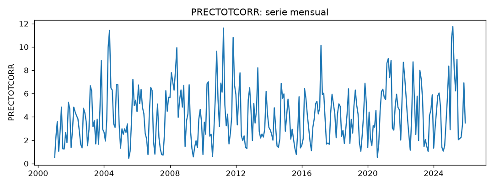
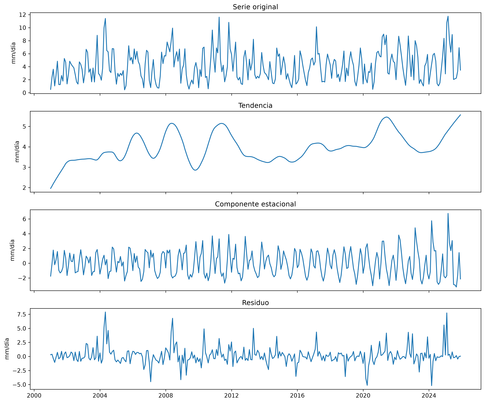
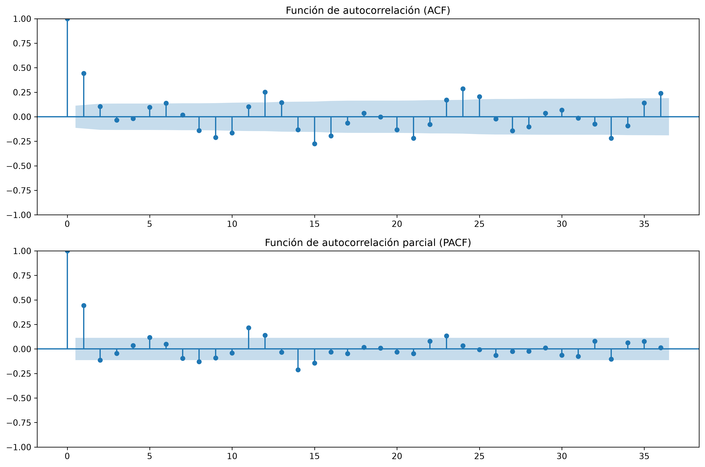
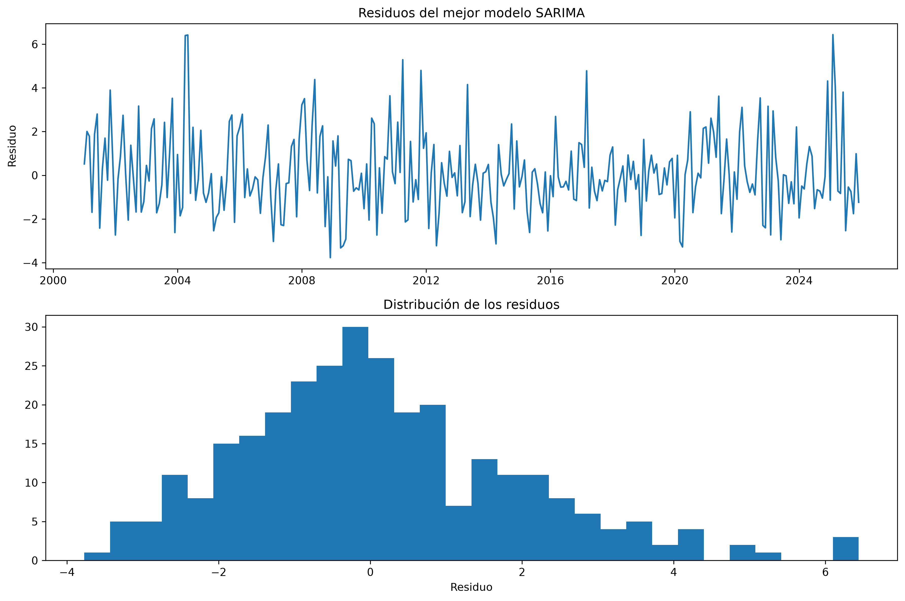

# Informe del miniproyecto 1

## 1. La serie

La serie seleccionada corresponde a la precipitación media mensual de Florencia, Caquetá, Colombia. Los datos fueron obtenidos de **NASA POWER (Prediction Of Worldwide Energy Resources)**, mediante su API de datos meteorológicos, utilizando el parámetro `PRECTOTCORR`, que representa la precipitación corregida. La variable se expresa en milímetros por día (mm/día), por lo que corresponde a una tasa media de precipitación y no a una acumulación mensual.

La información se obtuvo para las coordenadas geográficas de Florencia (latitud 1.6144 y longitud -75.6062), utilizando datos del producto MERRA-2. Según la ficha de datos documentada en el repositorio, la información se distribuye bajo licencia Creative Commons Atribución 4.0 Internacional (CC BY 4.0).

La serie tiene frecuencia mensual y comprende el periodo entre enero de 2001 y diciembre de 2025, para un total de **300 observaciones**. Se seleccionó esta variable por su relevancia para el contexto ambiental y agrícola de la región amazónica, donde el comportamiento de las precipitaciones constituye un factor importante para las actividades productivas. Adicionalmente, la serie permite estudiar patrones temporales y estacionales, así como evaluar modelos de pronóstico aplicados a variables meteorológicas.



### Análisis de valores faltantes y datos atípicos

En la revisión de la calidad de los datos se identificaron **cero valores faltantes** en las 300 observaciones, por lo que no fue necesario aplicar procedimientos de imputación.

Mediante el criterio del rango intercuartílico (IQR) se detectaron cinco posibles valores atípicos. Para su identificación se utilizó la siguiente expresión:

$$
IQR = Q_3 - Q_1
$$

Los límites para identificar posibles valores atípicos se calcularon mediante:

$$
L_{\text{inferior}} = Q_1 - 1.5(IQR)
$$

$$
L_{\text{superior}} = Q_3 + 1.5(IQR)
$$

El límite superior obtenido fue de 10.746 mm/día y el inferior de -2.864 mm/día. Los registros identificados fueron:

| Fecha | Precipitación (mm/día) |
|---|---:|
| Mayo de 2004 | 11.41 |
| Abril de 2011 | 11.61 |
| Noviembre de 2011 | 10.81 |
| Febrero de 2025 | 10.77 |
| Marzo de 2025 | 11.75 |

Aunque estos registros superan el límite superior establecido por el criterio IQR, se decidió conservarlos en la serie original. Esta decisión se tomó porque no se encontró evidencia que permitiera clasificarlos como errores de medición y, al tratarse de una variable meteorológica, podrían representar eventos reales de precipitación elevada. Su eliminación podría alterar la variabilidad natural de la serie y afectar el análisis de sus patrones temporales.

Por tanto, la función de preparación conserva los cinco registros y verifica que no existan valores faltantes. La decisión registrada en el código fue:

> No se identificaron valores faltantes. Se detectaron 5 posibles valores atípicos mediante IQR, pero se conservaron por no existir evidencia de errores de medición.

## 2. Componentes



Se realizó una descomposición STL robusta (*Seasonal and Trend decomposition using Loess*) con un periodo de 12 meses, correspondiente a la frecuencia anual de la serie. Este procedimiento permitió separar la precipitación observada en tres componentes: tendencia, estacionalidad y residuo.

La tendencia presenta un comportamiento variable a lo largo del periodo de estudio. No se observa un crecimiento o decrecimiento sostenido durante los 25 años analizados, sino fluctuaciones en el nivel de precipitación, con diferentes etapas de aumento y disminución. Hacia el tramo final de la serie se aprecia un incremento de la tendencia estimada. Esto evidencia que, además del patrón estacional anual, existen variaciones de largo plazo en el comportamiento de la precipitación en Florencia.

En cuanto al componente estacional, se identifican diferencias en el comportamiento de la precipitación según el mes del año. Los valores de la componente estacional permiten destacar los siguientes resultados:

**Meses con mayor componente estacional (por encima de la tendencia):**

- **Noviembre:** +2.054 mm/día.
- **Abril:** +1.865 mm/día.
- **Marzo:** +1.844 mm/día.

**Meses con menor componente estacional (por debajo de la tendencia):**

- **Agosto:** -2.206 mm/día.
- **Julio:** -1.778 mm/día.
- **Septiembre:** -1.559 mm/día.

Los valores positivos indican meses en los que la precipitación tiende a ubicarse por encima de la tendencia estimada, mientras que los valores negativos indican meses en los que tiende a ubicarse por debajo de ella. Estos resultados evidencian un patrón estacional anual en la precipitación de Florencia.

Finalmente, el análisis de los residuos permitió identificar las variaciones que no son explicadas por la tendencia ni por el componente estacional. El residuo de mayor magnitud absoluta se presentó en **mayo de 2004**, con un valor aproximado de **+7.903 mm/día**. También se identificó un residuo negativo importante en marzo de 2024, cercano a -5.186 mm/día.

En conjunto, la descomposición STL evidencia que la precipitación en Florencia presenta un patrón estacional anual definido, acompañado de fluctuaciones en su tendencia y variaciones puntuales que no son completamente explicadas por los componentes principales.

## 3. Líneas base y backtest

La evaluación de los modelos se realizó mediante un procedimiento de backtest de origen móvil (*rolling-origin backtesting*), utilizando los últimos 24 meses de la serie como periodo de prueba y un horizonte de pronóstico de 12 meses.

La serie contiene 300 observaciones mensuales, comprendidas entre enero de 2001 y diciembre de 2025. El procedimiento comienza con un primer entrenamiento de 276 observaciones, desde enero de 2001 hasta diciembre de 2023, y genera un pronóstico para los siguientes 12 meses, correspondientes a enero-diciembre de 2024.

Posteriormente, el origen de pronóstico avanza un mes en cada iteración, incorporando la observación más reciente al conjunto de entrenamiento. De esta manera, se obtienen **13 orígenes móviles**, desde diciembre de 2023 hasta diciembre de 2024, con un horizonte de 12 meses en cada uno. En conjunto, el periodo evaluado comprende desde enero de 2024 hasta diciembre de 2025. Los horizontes de pronóstico de los diferentes orígenes se superponen.

Para evitar la fuga de información (*data leakage*), en cada origen el modelo recibe únicamente las observaciones disponibles hasta ese momento. Esto se garantiza mediante la instrucción `entrenamiento = serie.iloc[:corte]`, que selecciona exclusivamente los datos anteriores al origen. Las observaciones posteriores se utilizan únicamente para comparar los pronósticos con los valores reales y calcular las métricas de evaluación.

Se utilizaron dos modelos de referencia o líneas base:

- **Ingenuo:** utiliza como pronóstico el último valor observado de la serie para todos los meses del horizonte.
- **Estacional ingenuo:** utiliza como pronóstico el valor registrado en el mismo mes del año anterior, aprovechando la periodicidad anual de la precipitación.

Los resultados obtenidos mediante el backtest fueron:

| Modelo | RMSE | MAE | MAPE (%) |
|---|---:|---:|---:|
| Ingenuo | 4.09 | 3.38 | 86.96 |
| Estacional ingenuo | 3.23 | 2.28 | 40.53 |

Las métricas utilizadas para evaluar el desempeño fueron la raíz del error cuadrático medio (RMSE), el error absoluto medio (MAE) y el error porcentual absoluto medio (MAPE). Sus expresiones matemáticas son:

$$
RMSE = \sqrt{\frac{1}{n}\sum_{t=1}^{n}(y_t-\hat{y}_t)^2}
$$

$$
MAE = \frac{1}{n}\sum_{t=1}^{n}|y_t-\hat{y}_t|
$$

$$
MAPE = \frac{100}{n}\sum_{t=1}^{n}
\left|\frac{y_t-\hat{y}_t}{y_t}\right|
$$

Donde $y_t$ representa el valor real, $\hat{y}_t$ el valor pronosticado y $n$ el número de observaciones evaluadas.

Al comparar los resultados, el **modelo estacional ingenuo obtuvo un mejor desempeño en las tres métricas**. Su RMSE fue de 3.23 frente a 4.09 del modelo ingenuo; su MAE fue de 2.28 frente a 3.38, y su MAPE fue de 40.53 % frente a 86.96 %.

Estos resultados indican que utilizar la precipitación registrada en el mismo mes del año anterior proporciona pronósticos más precisos que utilizar únicamente el último valor observado. Esto evidencia la importancia del comportamiento estacional anual en la serie de precipitación de Florencia y establece el modelo estacional ingenuo como la línea base de referencia para evaluar los modelos clásicos.

## 4. Estacionariedad e identificación

Para evaluar la estacionariedad de la serie de precipitación se aplicó la prueba aumentada de Dickey-Fuller (ADF) a cuatro versiones de los datos: la serie original, su primera diferencia regular, su diferencia estacional de periodo 12 y la combinación de ambas diferencias.

La prueba ADF contrasta las siguientes hipótesis:

$$
H_0: \text{La serie presenta una raíz unitaria (no es estacionaria)}
$$

$$
H_1: \text{La serie no presenta una raíz unitaria (es estacionaria)}
$$

Se estableció un nivel de significancia de $\alpha = 0.05$. Los resultados obtenidos fueron:

| Versión de la serie | Estadístico ADF | Valor p | Resultado |
|---|---:|---:|---|
| Original | -5.1738 | 0.000010 | Estacionaria |
| Diferencia regular | -6.7823 | < 0.000001 | Estacionaria |
| Diferencia estacional | -6.7053 | < 0.000001 | Estacionaria |
| Diferencia regular y estacional | -7.4214 | < 0.000001 | Estacionaria |

En los cuatro casos, los valores p fueron inferiores al nivel de significancia de 0.05, por lo que se rechazó la hipótesis nula de existencia de raíz unitaria. Esto indica que las cuatro versiones presentan evidencia estadística de estacionariedad según la prueba ADF.

Debido a que la serie original ya presentó evidencia de estacionariedad, se decidió no aplicar diferenciación regular ni estacional. Por tanto, los órdenes seleccionados fueron:

$$
d = 0
$$

$$
D = 0
$$

Esta decisión permite conservar la información original de la serie y evita aplicar diferenciaciones innecesarias. Sin embargo, la prueba ADF por sí sola no descarta todas las formas de comportamiento estacional, por lo que la identificación también se complementó con el análisis de las funciones de autocorrelación.



### Identificación mediante ACF y PACF

La función de autocorrelación (ACF) permite identificar la relación entre la serie y sus valores anteriores, mientras que la función de autocorrelación parcial (PACF) mide esa relación después de controlar la influencia de los rezagos intermedios.

En la ACF se observa una autocorrelación positiva importante en el rezago 1, con un valor aproximado de 0.44. También se identifican valores que sobresalen de las bandas de confianza en algunos rezagos estacionales, especialmente en los rezagos 12, 24 y 36, con valores positivos aproximados de 0.25, 0.29 y 0.24, respectivamente. Adicionalmente, aparecen autocorrelaciones negativas en los rezagos 9, 10, 15, 16 y 21.

En la PACF se destaca principalmente el rezago 1, con una autocorrelación parcial aproximada de 0.44. También se observan valores significativos en los rezagos 5, 11, 12, 14, 15 y 23. Estas señales muestran que existen dependencias temporales tanto de corto plazo como asociadas a la periodicidad anual.

A partir de estos patrones se consideró conveniente explorar componentes autorregresivos y de media móvil. La señal del primer rezago sugirió evaluar órdenes regulares de primer orden, mientras que las autocorrelaciones cercanas a los múltiplos de 12 justificaron considerar componentes estacionales.

Por esta razón, se evaluó una rejilla de modelos SARIMA con valores de 0 y 1 para los parámetros $p$, $q$, $P$ y $Q$, manteniendo los órdenes de diferenciación seleccionados ($d=0$ y $D=0$) y un periodo estacional de 12 meses. La selección definitiva se realizó mediante la comparación del criterio de información de Akaike (AIC).

## 5. Modelos clásicos

### Selección del modelo SARIMA

Para seleccionar el modelo se realizó una búsqueda en una rejilla de combinaciones de órdenes autorregresivos y de media móvil, tanto regulares como estacionales. Se evaluaron los valores 0 y 1 para los parámetros $p$, $q$, $P$ y $Q$, manteniendo los órdenes de diferenciación previamente seleccionados ($d=0$ y $D=0$) y un periodo estacional de 12 meses.

En total se evaluaron 16 combinaciones. La selección se realizó utilizando el criterio de información de Akaike (AIC), que permite comparar modelos considerando su ajuste y complejidad. Los resultados fueron:

| Orden (p,d,q) | Orden estacional (P,D,Q,12) | AIC |
|---|---|---:|
| (1,0,1) | (1,0,1,12) | 1171.9957 |
| (1,0,0) | (1,0,1,12) | 1184.8709 |
| (0,0,1) | (1,0,1,12) | 1193.6843 |
| (0,0,0) | (1,0,1,12) | 1227.0546 |
| (1,0,1) | (1,0,0,12) | 1261.1817 |
| (1,0,1) | (0,0,1,12) | 1275.0418 |
| (1,0,0) | (1,0,0,12) | 1288.5385 |
| (1,0,0) | (0,0,1,12) | 1299.8554 |
| (0,0,1) | (1,0,0,12) | 1342.5237 |
| (1,0,1) | (0,0,0,12) | 1352.0521 |
| (1,0,0) | (0,0,0,12) | 1369.0603 |
| (0,0,0) | (1,0,0,12) | 1391.3786 |
| (0,0,1) | (0,0,1,12) | 1438.8879 |
| (0,0,1) | (0,0,0,12) | 1566.4960 |
| (0,0,0) | (0,0,1,12) | 1582.2412 |
| (0,0,0) | (0,0,0,12) | 1780.4252 |

El menor valor de AIC correspondió al modelo **SARIMA(1,0,1)(1,0,1,12)**, con un AIC de 1171.9957. Por esta razón, se seleccionó como el mejor modelo dentro de las combinaciones evaluadas.

Su representación general es:

$$
SARIMA(1,0,1)(1,0,1)_{12}
$$

La ecuación del modelo, expresada mediante el operador de rezago $B$, es:

```math
(1-\phi_1 B)(1-\Phi_1 B^{12})y_t
=
c+(1+\theta_1 B)(1+\Theta_1 B^{12})\varepsilon_t
```

Donde $\phi_1$ y $\Phi_1$ representan los parámetros autorregresivos regular y estacional, respectivamente; $\theta_1$ y $\Theta_1$ representan los parámetros de media móvil regular y estacional; $c$ es la constante y $\varepsilon_t$ es el término de error.

### Diagnóstico de los residuos



Después de seleccionar el modelo se analizaron sus residuos para evaluar si conservaban patrones temporales que no hubieran sido explicados por el modelo.

En la gráfica temporal se observa que los residuos fluctúan alrededor de cero, sin presentar una tendencia sostenida claramente identificable. Sin embargo, aparecen algunos valores extremos positivos y negativos, lo que indica que existen observaciones cuya variabilidad no es completamente explicada por el modelo.

El histograma muestra que la mayor concentración de residuos se encuentra alrededor de cero, aunque la distribución presenta cierta asimetría hacia la derecha y algunos valores positivos extremos. Por tanto, no se puede afirmar que los residuos sigan perfectamente una distribución normal.

Adicionalmente, se aplicó la prueba de Ljung-Box para evaluar la presencia de autocorrelación residual en los rezagos 12 y 24. Los resultados fueron:

| Rezago | Estadístico Ljung-Box | Valor p |
|---|---:|---:|
| 12 | 13.5980 | 0.3271 |
| 24 | 19.7080 | 0.7133 |

La prueba de Ljung-Box contrasta las siguientes hipótesis:

$$
H_0: \text{No existe autocorrelación residual hasta el rezago evaluado}
$$

$$
H_1: \text{Existe autocorrelación residual hasta el rezago evaluado}
$$

Como los valores p obtenidos fueron superiores a 0.05 en ambos rezagos, no se rechazó la hipótesis nula. Esto indica que no se encontró evidencia estadísticamente significativa de autocorrelación residual hasta los rezagos evaluados.

En conjunto, los resultados sugieren que el modelo captura una parte importante de la estructura temporal de la serie. No obstante, la presencia de algunos residuos extremos y la forma de su distribución muestran que el ajuste no es perfecto.

### Incorporación de una variable exógena: SARIMAX

Como extensión del modelo SARIMA se implementó un modelo SARIMAX, incorporando como variable exógena el número de días de cada mes (`dias_mes`).

Esta variable representa una característica del calendario que se conoce de antemano, ya que el número de días de un mes determinado está establecido en el calendario. Por tanto, puede utilizarse para generar pronósticos futuros sin necesidad de conocer previamente los valores reales de precipitación.

La incorporación de esta variable permitió evaluar si la información del calendario aportaba capacidad predictiva adicional al modelo SARIMA. Para realizar una comparación justa, ambos modelos fueron evaluados mediante el mismo procedimiento de backtest, utilizando los mismos orígenes y horizontes de pronóstico.

Los resultados fueron:

| Modelo | RMSE | MAE | MAPE (%) |
|---|---:|---:|---:|
| SARIMA(1,0,1)(1,0,1,12) | 3.01 | 2.13 | 36.96 |
| SARIMAX(1,0,1)(1,0,1,12) + días del mes | 2.99 | 2.19 | 42.57 |

El modelo SARIMAX obtuvo un RMSE ligeramente inferior al SARIMA, pasando de 3.01 a 2.99. Sin embargo, presentó valores superiores en MAE y MAPE: el MAE pasó de 2.13 a 2.19 y el MAPE de 36.96 % a 42.57 %.

Por consiguiente, la incorporación del número de días del mes produjo una mejora marginal en RMSE, pero no representó una mejora general en las tres métricas de evaluación. Esto indica que la variable exógena evaluada no aportó una mejora consistente en la capacidad predictiva del modelo.

En consecuencia, aunque el SARIMAX presentó el menor RMSE, el SARIMA obtuvo mejores resultados en MAE y MAPE. La elección entre ambos depende de la métrica que se considere prioritaria para la aplicación del pronóstico.

## 6. Tabla de métricas

Los resultados de la evaluación se presentan ordenados de menor a mayor RMSE. Se comparan las dos líneas base (ingenuo y estacional ingenuo) con los modelos SARIMA y SARIMAX. La columna decisión registra el tratamiento aplicado a los datos antes del modelado.

| Modelo | Decisión | RMSE | MAE | MAPE (%) |
|---|---|---:|---:|---:|
| SARIMAX(1, 0, 1)(1, 0, 1, 12) + exógenas | Se conservaron los 5 posibles valores atípicos identificados mediante IQR, al no existir evidencia de errores de medición. No se identificaron valores faltantes. | 2.99 | 2.19 | 42.57 |
| SARIMA(1, 0, 1)(1, 0, 1, 12) | Se conservaron los 5 posibles valores atípicos identificados mediante IQR, al no existir evidencia de errores de medición. No se identificaron valores faltantes. | 3.01 | 2.13 | 36.96 |
| Estacional ingenuo | Se conservaron los 5 posibles valores atípicos identificados mediante IQR, al no existir evidencia de errores de medición. No se identificaron valores faltantes. | 3.23 | 2.28 | 40.53 |
| Ingenuo | Se conservaron los 5 posibles valores atípicos identificados mediante IQR, al no existir evidencia de errores de medición. No se identificaron valores faltantes. | 4.09 | 3.38 | 86.96 |

## 7. Conclusión

A partir de los resultados del backtest, se selecciona el modelo **SARIMA(1,0,1)(1,0,1,12)** como el mejor modelo clásico en términos generales, debido a que presenta un desempeño superior al de la mejor línea base, el modelo estacional ingenuo, en las tres métricas de evaluación.

La comparación entre ambos modelos muestra las siguientes mejoras:

| Métrica | Estacional ingenuo | SARIMA | Mejora del SARIMA |
|---|---:|---:|---:|
| RMSE | 3.23 | 3.01 | 6.81 % |
| MAE | 2.28 | 2.13 | 6.58 % |
| MAPE (%) | 40.53 | 36.96 | 8.81 % |

Las mejoras porcentuales se calcularon mediante la siguiente expresión:

$$
\text{Mejora}(\%) =
\frac{\text{Métrica}_{\text{base}}-\text{Métrica}_{\text{modelo}}}
{\text{Métrica}_{\text{base}}}\times 100
$$

Estos resultados indican que el modelo SARIMA consigue reducir el error cuadrático medio, el error absoluto medio y el error porcentual absoluto medio frente a la línea base estacional. En particular, la mayor mejora relativa se presenta en el MAPE, con una reducción del 8.81 %.

Por otra parte, aunque el modelo SARIMAX obtuvo el menor RMSE (2.99), sus valores de MAE (2.19) y MAPE (42.57 %) fueron superiores a los del SARIMA. Esto evidencia que la incorporación del número de días del mes como variable exógena no produjo una mejora consistente en las tres métricas.

En cuanto a las limitaciones, el diagnóstico de los residuos muestra que el modelo todavía presenta errores puntuales de magnitud considerable, tanto positivos como negativos. Estos comportamientos son visibles en distintos momentos de la serie, especialmente alrededor de 2004 y en el tramo final del periodo analizado. Esto sugiere que existen variaciones de precipitación que no son completamente explicadas por la estructura autorregresiva, de media móvil y estacional del modelo. La gráfica de residuos permite identificar estos episodios, aunque no permite establecer por sí sola cuáles meses presentan los mayores errores exactos.

En conclusión, el modelo SARIMA(1,0,1)(1,0,1,12), con órdenes de diferenciación $d=0$ y $D=0$, constituye el mejor referente clásico obtenido en este miniproyecto. Su desempeño supera al de la mejor línea base en las tres métricas evaluadas, aunque todavía presenta oportunidades de mejora en la predicción de variaciones extremas de precipitación.

Por tanto, este modelo se establece como **línea de referencia para el miniproyecto 2**, cuyo objetivo será desarrollar y evaluar alternativas de inteligencia artificial que logren superar sus resultados en RMSE, MAE y MAPE, utilizando el mismo conjunto de datos y un procedimiento de evaluación comparable.
